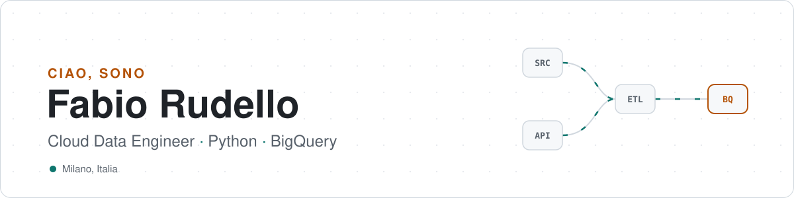

<picture>
  <source media="(prefers-color-scheme: dark)" srcset="assets/banner-dark.svg">
  <source media="(prefers-color-scheme: light)" srcset="assets/banner-light.svg">
  
</picture>

  

## 👋 Chi sono

Sono **Fabio**, Cloud Data Engineer a **Milano**.
Progetto e mantengo pipeline di dati in cloud: porto i dati dalle sorgenti al data warehouse, li trasformo e li rendo pronti per analisi e reporting.

## 🛠️ Con cosa lavoro

  
  
  
  
  
  

<b>Cosa faccio, nel dettaglio</b>

 

- **Python** per pipeline ETL/ELT, automazioni e integrazioni con API
- **BigQuery** e **SQL** per modellare, trasformare e interrogare grandi volumi di dati
- **Google Cloud** come piattaforma per lo storage e l'elaborazione dei dati

## 📊 Statistiche

  <picture>
    <source media="(prefers-color-scheme: dark)" srcset="https://github-readme-stats.vercel.app/api?username=frudello&show_icons=true&include_all_commits=true&count_private=true&hide_border=true&theme=github_dark&title_color=14B8A6&icon_color=FBBF24">
    
  </picture>
  <picture>
    <source media="(prefers-color-scheme: dark)" srcset="https://github-readme-stats.vercel.app/api/top-langs/?username=frudello&layout=compact&hide_border=true&theme=github_dark&title_color=14B8A6">
    
  </picture>

  <picture>
    <source media="(prefers-color-scheme: dark)" srcset="https://streak-stats.demolab.com?user=frudello&theme=github-dark-blue&hide_border=true&background=0D1117&ring=14B8A6&fire=FBBF24&currStreakLabel=14B8A6">
    
  </picture>

<b>🌱 Da dove vengo</b>

 

Mi sono formato con il percorso [42](https://www.42network.org/): solo progetti e peer review, partendo dal C e dai fondamentali di sistemi.

| Progetto | Di cosa si tratta |
| --- | --- |
| [push_swap](https://github.com/frudello/push_swap) | Algoritmi di ordinamento con due stack e un set limitato di mosse |
| [pipex](https://github.com/frudello/pipex) | Processi e pipe in Unix (`fork`, `pipe`, `execve`) |
| [philosopher](https://github.com/frudello/philosopher) | Thread, mutex e concorrenza senza deadlock |

## 📫 Contatti

<!-- Sostituisci i link qui sotto con i tuoi e togli i commenti -->
<!--

-->
